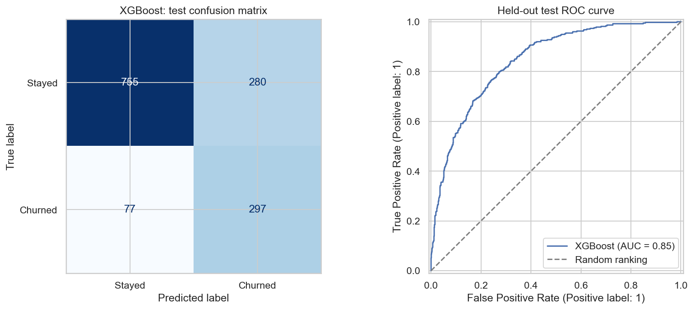

# Customer Churn Prediction

An end-to-end local machine-learning project using the supplied IBM Telco Customer Churn dataset: exploratory analysis, leakage-aware model comparison, and a Streamlit customer-risk application. XGBoost is the saved model; Logistic Regression is a close baseline. No deployment is configured.

## Project structure

```text
Customer-Churn-Prediction/
├── data/
│   ├── raw/                 # Original dataset copy
│   └── processed/           # Cleaned datasets created later
├── notebooks/
│   ├── 01_EDA.ipynb         # Original EDA
│   └── 02_Model_Training.ipynb # Executed model comparison
├── app.py                  # Streamlit entry point
├── models/                 # Pipeline and training metadata
├── tests/                  # Input, UI, and evaluation regression tests
├── .github/workflows/      # Automated test workflow
├── reports/
│   └── figures/             # Saved charts created later, if desired
├── src/                     # Validated prediction interface
├── requirements.txt
└── Telco-Customer-Churn.txt # Original supplied file
```

## Run the notebook

From the project root:

```bash
python -m venv .venv
```

Activate the environment, then install the dependencies:

```bash
# Windows PowerShell
.\.venv\Scripts\Activate.ps1
pip install -r requirements.txt
jupyter lab
```

Open `notebooks/01_EDA.ipynb` and run the cells from top to bottom.

## Cleaning decisions documented in the notebook

- Text fields are trimmed so accidental spaces do not become separate categories.
- `TotalCharges` is converted from text to numeric values.
- Rows with missing `TotalCharges` are removed because the field cannot be used reliably for EDA until it has a valid value.
- `customerID` is removed from analysis because it identifies a customer but does not describe a customer behavior or service.
- `SeniorCitizen` is displayed as `Yes`/`No` in the analysis to make charts easier to interpret.

## What comes next

Phase 2 adds feature preparation, train/test splitting, baseline models, evaluation metrics, and interpretation in a separate notebook described below.
 
## Phase 2 — Model training

Phase 2 is now implemented separately in `notebooks/02_Model_Training.ipynb`; Phase 1 remains unchanged. Install the updated requirements, then run the notebook from top to bottom. It compares Logistic Regression, Random Forest, and XGBoost with stratified five-fold cross-validation on an 80% training split. Class weighting handles imbalance; preprocessing is fitted independently inside each fold. The winner is selected by mean CV ROC-AUC before evaluating the 20% test split.

Outputs include `models/best_churn_pipeline.joblib`, `models/model_metadata.json`, `reports/phase2_cv_scores.csv`, and `reports/figures/phase2_test_evaluation.png`. The saved pipeline includes imputation, encoding, scaling, and the trained classifier. The metadata records feature columns, versions, and evaluation metrics. Load only trusted joblib artifacts and use the recorded package versions when reproducing predictions.

The 11 missing TotalCharges values are retained and imputed from training data. Neither Churn nor ChurnFlag is a model input.

## Phase 3 — Local Streamlit application

Use Python 3.13 (the saved artifact was trained with Python 3.13.9). From the project root, activate your environment and run:

```powershell
python -m pip install -r requirements.txt
python -m streamlit run app.py --server.address 127.0.0.1
```

Open http://127.0.0.1:8501. Enter customer demographics, billing, and services, then choose **Calculate churn risk**. The result shows an estimated probability and a churn/stay classification at the saved 0.5 threshold. Changing inputs clears the previous result. The app does not persist customer inputs.

`app.py` supplies the interface, `src/prediction.py` validates and scores inputs, and `tests/test_prediction.py` checks validation, saved-model inference, and the Streamlit interaction. Both notebooks and the trained artifact are preserved. No deployment is configured.

Inputs must match all 19 model features. Categories and service combinations are validated; tenure must be whole months from 0 to 72. Charges must be finite and non-negative. Unavailable total charges are passed as missing values to the saved imputer. Charges above the dataset range show a warning. No customer ID or target label is accepted as a feature.

The model was class-weighted and its probabilities have not been calibrated. Treat results as decision support. Test recall was 79.4% and precision was 51.5%; false alerts are expected. The app loads only the local trusted joblib artifact, verifies its schema and estimator, and shows a setup error if loading fails. Requirements pin the model serialization dependencies to their training versions. The optional `.phase2_packages` directory supports the existing local XGBoost installation; a clean install uses requirements.txt.

Run tests with:

```powershell
python -m pytest tests -q
```

For a headless local check:

```powershell
python -m streamlit run app.py --server.address 127.0.0.1 --server.headless true
```

The health endpoint is http://127.0.0.1:8501/_stcore/health. Stop the local server with Ctrl+C.

## Verified evaluation

The stratified seed-42 split contains 5,634 training and 1,409 test customers. Selection uses five-fold training CV ROC-AUC; test results are not used for model selection. Re-running `tests/test_evaluation.py` independently reconstructs the split, scores the saved pipeline, and checks the reported metrics and fitted numeric preprocessing statistics.

| Model | Mean CV ROC-AUC | Fold standard deviation |
|---|---:|---:|
| XGBoost | 0.8478 | 0.0118 |
| Logistic Regression | 0.8460 | 0.0138 |
| Random Forest | 0.8371 | 0.0115 |

Selected-model test precision is **0.5147**, recall **0.7941**, F1 **0.6246**, and ROC-AUC **0.8455**. At threshold 0.5, the confusion matrix is `[[755, 280], [77, 297]]` (rows: actual stay/churn; columns: predicted stay/churn). The model catches 297 churners but raises 280 false alerts. The CV advantage over Logistic Regression is small and is not evidence of statistically significant superiority.



## Leakage checks and limitations

- IDs and target copies are excluded. Imputation, scaling, encoding, and imbalance weights are fitted within each training fold. The saved pipeline is fitted on the training split only.
- Phase 1 explored the full dataset, so the holdout is not wholly unseen at the project level. Validate on a new cohort before claiming generalization to real customers.
- Probabilities are not calibrated. The 0.5 threshold is a baseline, not a business-cost optimum. Tune thresholds on training validation data, never this test set.
- Tenure above 72 months is rejected. Extreme charges warn but are allowed; no billing-history consistency check is possible from these aggregate fields alone.
- There is no temporal validation, subgroup fairness audit, or production monitoring. Confirm that each predictor exists at the intended prediction time. Gender and senior-citizen status are currently model inputs.
- Saved CV aggregates are checked against metadata; the review does not retrain all folds. A complete reproducibility run requires executing Phase 2 again. The saved holdout metrics are independently recomputed without refitting.

## GitHub preparation

The test workflow runs on pushes and pull requests once you publish the repository. It has not yet been run on GitHub; Linux CI remains to be verified.

Dataset contents were verified byte-for-byte against IBM's upstream CSV. See [dataset attribution and checksum](data/README.md) and the [bundled Apache-2.0 license](LICENSES/IBM-Apache-2.0.txt). Raw data and trained results are unchanged; saved notebook outputs now use relative paths.

No project code license has been adopted. Confirm the copyright-holder name and license before offering the code under MIT terms. Third-party dataset terms remain separate.

`.gitignore` excludes virtual environments, the local XGBoost package directory, caches, logs, `.env` files, and Streamlit secrets. Review staged files manually; do not commit credentials or customer data. Keep the trusted pipeline and metadata together, or document how to regenerate them with Phase 2. Publishing this repository does not deploy the application.

See [PUBLICATION_CHECKLIST.md](PUBLICATION_CHECKLIST.md) for files to include and final approval items.

## Reproducible installation and operational safeguards

For the exact Windows Python 3.13 dependency set used in the publication check, install `requirements-lock-windows.txt` in a new virtual environment. `requirements.txt` remains the cross-platform entry point; the Windows snapshot includes Windows-specific dependencies and must not be used directly on Linux.

```powershell
python -m venv .venv
.\.venv\Scripts\python.exe -m pip install -r requirements-lock-windows.txt
.\.venv\Scripts\python.exe -m pip check
.\.venv\Scripts\python.exe -m pytest -q
.\.venv\Scripts\python.exe -m streamlit run app.py
```

The saved pipeline is checked against `models/artifact.sha256` before deserialization. This detects accidental corruption, not malicious replacement of both files: accept model artifacts only from trusted sources. Phase 2 regenerates the checksum when saving a new model. Restart Streamlit after replacing an artifact because the pipeline is cached.

`.streamlit/config.toml` binds to localhost, disables telemetry, and enables CORS and XSRF protection. Unexpected load/inference failures are logged server-side without explicitly logging customer profiles; users see a short error message. No customer inputs are persisted by application code.

Public production use still requires a hosting/access-control and TLS plan, operational monitoring, a retention policy, and validation on representative recent customers. Calibration, business-cost threshold selection, and subgroup evaluation remain model limitations. These are not established by passing software tests. No external hosting or deployment is enabled here.
